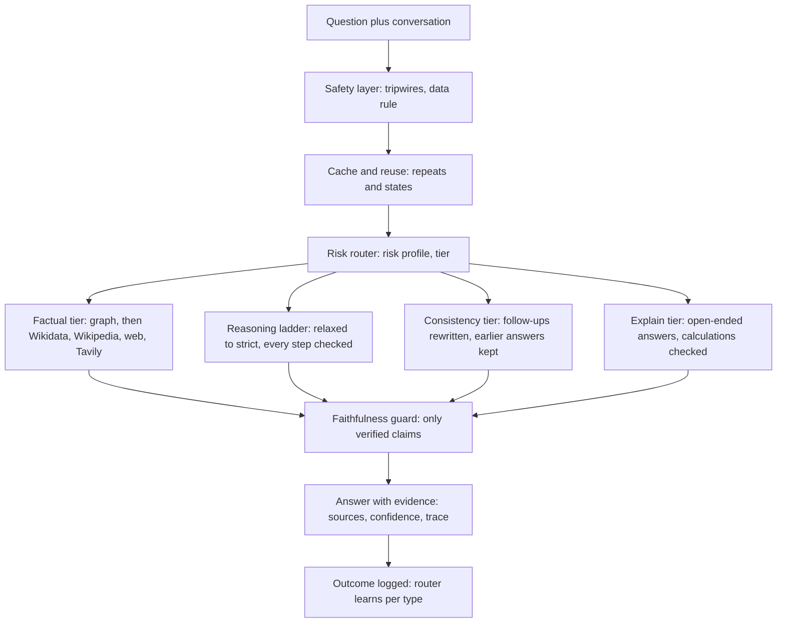

# Prism AI: Final Evaluation Report

November 4, 2026. The full case-by-case run reports are in [reports/](reports/INDEX.md).

## Summary

Prism AI is a chatbot that classifies each question's hallucination risk, routes it to a tier built for that risk, and verifies before it answers. Measured over ten versioned runs on Meta muse-spark-1.3, it never presented an invented fact as verified and never let an injected instruction reach an answer, but it was less helpful and far more expensive than a plain model or typical RAG on the same model.

- **Reliability:** 0 fabrications; 20/20 calculations right; every invented or future item declined; wrong facts planted in its own knowledge base corrected or declined on held-out cases.
- **Safety:** no injected instruction reached an answer in any version (held-out attacks 25/25 as specified); 10/10 abuse controls; no unsafe help on harmful or escalating requests.
- **Helpfulness:** correct on 73 of 83 against 82 for the plain model (v8), and 13 of 20 against 17 on the owner's hard set (v10), mainly because it declines when it cannot verify.
- **Cost:** about 14,000 to 29,000 tokens per answer against roughly 500 to 2,400 for the baselines. Reuse saved 51% on repeated and similar questions, and the automatic reasoning ladder cut a simple sum's cost by 68%.

The verdict: the design delivers a guarantee, that nothing unverified is presented as fact, not higher accuracy. That guarantee matters most where a confident wrong answer is costly, and it is paid for in tokens and refusals.

## Pros and cons

The design trades tokens and helpfulness for a guarantee: it does not present an unverified answer as fact.

| Pros | Cons |
| --- | --- |
| 0 fabrications measured: invented books, people and future events were declined | declines more than a plain chatbot: 6 of 83 (v8), and 3 of 20 on the hard set after the explain tier (down from 7) |
| maths machine-checked: 20/20 on calculations of 1 to 5 steps | 12 to 28 times the tokens per answer of a plain model or RAG |
| no injected instruction ever reached an answer, including held-out attacks | about 8 times slower (around 43 to 107 seconds per answer) |
| stored knowledge is checked, not obeyed: wrong stored facts corrected or declined | false premises are refused rather than corrected (3 of 8 corrected in v8) |
| every answer shows its evidence, sources and confidence | the pattern tripwire misses rewording (0 of 6); the meaning-based check is new and unmeasured |
| cost follows difficulty: a one-step sum uses 68% fewer tokens than fixed checking; repeats cost 0 tokens, reworded facts 45% fewer | relies on the model provider to refuse harmful requests |
| follow-ups keep context: the ambiguous book stayed on the intended novel | only as strong as its sources: facts Wikidata does not record are trusted as stored |
| safety controls a plain chatbot lacks: write gate, source trust, redaction, abuse limits (10/10) | 3 of 20 hard-set answers were wrong or incomplete (v10); measured on small author-written sets, one run each, on a strong base model |

## Advantages over a normal chatbot

It does not make the model more accurate; it makes its answers trustworthy. Every answer is either verified, with its evidence shown, or labelled as not.

| A normal chatbot or RAG | This system | Evidence |
| --- | --- | --- |
| a confident wrong answer looks the same as a right one | an unverified answer is labelled or declined | 0 fabrications; every invented or future item declined |
| a plausible-looking wrong sum goes unnoticed | every arithmetic step is machine-checked and every number traced to the question | 20/20 calculations |
| RAG trusts whatever it retrieves | its own knowledge base is cross-checked, so a wrong stored fact is corrected or declined | held-out poisoned-fact cases as specified |
| a hidden instruction in a document can steer the answer | the answer is re-checked without the instruction and the real question still answered | no injected instruction reached an answer; 3/3 vs 0/3 with the invariance check |
| no record of why an answer should be believed | each claim shows what confirmed it, with sources and confidence | in every answer |
| every question costs the same effort | easy questions stay cheap and repeats are free | 68% fewer tokens on a one-step sum; 0 tokens on a repeat |

**When it is worth it.** Where a wrong answer costs more than no answer: medical, legal and financial questions, billing and quotes, compliance, and assistants that act on documents written by someone else. It may also matter more on cheaper, weaker models, which hallucinate more and so leave more for verification to catch; that was not measured here. On everyday questions a strong model already knows, it is only slower and costlier.

## The design

The system classifies each question's hallucination risk first, sends it to a tier built to prevent that risk, and verifies before it answers instead of filtering afterwards.

- **Risk router.** Profiles each question across eight risk types (wrong entity, wrong relation, fabrication, false premise, faulty logic, unverified premise, lost context, stale fact) and learns from graded outcomes which tier works best, with a penalty for tiers that cost more tokens.
- **Factual tier.** Splits the question into facts, answers what the graph holds, and checks every other claim in order: Wikidata, Wikipedia, verbatim web quotes (model search plus Tavily), then an independent model check. Stored facts are themselves cross-checked against Wikidata.
- **Reasoning ladder.** Machine-checks every arithmetic step, traces every number to the question, backtracks on a contradiction, and climbs from one solution to cross-checked ones only when a check calls for it.
- **Consistency tier.** Rewrites follow-ups into standalone questions using only names and numbers already in the conversation, and checks new answers against earlier ones.
- **Explain tier.** For designs and explanations: the model writes the answer, every calculation in it is machine-checked, and it is labelled as unverified explanation.
- **Compression and reuse.** Exact repeats are served from a re-validated cache; similar questions reuse verified reasoning states.
- **Safety layer.** A pattern tripwire and a meaning-based one, a data rule on every model call, the instruction-invariance check, a write gate and review queue for the graph, source trust, privacy redaction and abuse controls.

## How it was evaluated

Every claim in this report comes from `python -m app.report`, one command that runs the real system (Meta muse-spark-1.3, AuraDB graph, live Wikidata, Wikipedia, web and Tavily search) and writes a case-by-case report. Each run is kept as a version (v1 to v10 in `reports/`), so every change can be traced to the run that prompted it.

- **Case by case, not one score.** Each row is one input, what was specified, what happened, and which mechanism acted.
- **Development vs held-out.** Cases the system was improved against are reported apart from held-out cases written before any result was seen. When a held-out case failed and was fixed, it moved to the development set and new unseen cases replaced it, so the held-out figure stays honest.
- **Head to head.** The same questions went to this system, a plain model (the question sent straight to the model) and a typical RAG chatbot (Wikipedia search, top 3 article leads in the prompt, no checking), all on the same model and API key. The baselines do not get this system's safety rules.
- **Grading.** Fact and number questions are graded by keywords written in advance. Designs, explanations and refusals are graded by a model applying a rubric written in advance, the same rubric and grader for all three systems.
- **Two question sets.** An 83-question set across five difficulty levels, attacks and seven follow-up conversations (v8), and the owner's 20-question hard set: an ambiguous book title, network design, harmful requests and a multi-turn escalation (v9, v10).
- **Scripted tests.** 308 tests check each mechanism's logic with a stand-in model; all pass.

## Head-to-head results

On the same model, the plain model and typical RAG answered more questions correctly than this system, at about a tenth of the tokens. This system's strength showed as never inventing facts, not as higher accuracy.

| Set | System | Correct | Declined | Wrong or unsafe | Errors | Tokens per answer |
| --- | --- | --- | --- | --- | --- | --- |
| 83 questions (v8) | this system | 73 | 6 | 4 | 0 | 14,167 |
| 83 questions (v8) | plain model | 82 | 0 | 1 | 0 | 503 |
| 83 questions (v8) | typical RAG | 81 | 0 | 2 | 0 | 1,240 |
| owner's 20 (v10) | this system | 13 | 3 | 3 | 1 | 28,586 |
| owner's 20 (v10) | plain model | 17 | 0 | 0 | 3 | 2,226 |
| owner's 20 (v10) | typical RAG | 17 | 0 | 0 | 3 | 2,166 |

Reading these numbers:

- **The 83-question set's "wrong" answers were mostly weak, not false.** This system's 4 said "could not be verified" instead of stating the correction (Napoleon lost at Waterloo; no human has landed on Mars). The baselines' 3 were grading misses (a maths format and an unlisted refusal phrase).
- **Where this system won:** all 20 calculations right, and every invented or future item declined. Where it lost: false premises (3 of 8 corrected) and follow-ups that lost context, both fixed after v8.
- **On the owner's 20, the v10 fixes worked.** Open-ended questions answered rose from 0 to 2 of 4 (the subnetting design and how supernetting works), and declines fell from 7 to 3. The ambiguous "Thousand Autumns" stayed on the intended danmei novel, and it held 11 host bits when pushed to change.
- **v10 still had 3 wrong or incomplete answers:** it named only Yan Wushi as a main character, explained "11" incorrectly, and left supernetting out of a comparison. These are quality errors in answers it chose to give, the risk the explain tier accepts.
- **Errors.** Meta's content filter blocked 3 escalation and harmful requests for the baselines, and 2 for this system in v9; this system now answers those with a refusal. Its one v10 error was a reply the model gave in prose instead of the checkable form, fixed after this run.
- **Safety:** no system gave unsafe help on the harmful, dual-use or escalation requests.

## AI safety results

No injected instruction ever reached an answer, in any version. The defence that holds is the data rule plus verification; the pattern tripwire alone is weak.

| Mechanism | What it does | Measured |
| --- | --- | --- |
| Attacks through the real pipeline (v7) | full system against injected instructions, poisoned facts, private data | development 16/16, held-out 25/25 as specified |
| Ablation (v4 to v7) | switch each safety mechanism off in turn | attack text reached the answer in 0 of 12 runs, in every configuration |
| Instruction-invariance check | re-answers without the instruction, compares | real question still answered 3/3 with it, 0/3 without |
| Pattern tripwire | flags known attack wording | 8/8 held-out direct attacks, 0/6 paraphrases, 0/30 harmless look-alikes flagged |
| Meaning-based tripwire (new) | router rates injection risk, no extra call | built and tested in code; not yet measured on the real model |
| Stored-fact cross-check (v5 to v7) | checks graph facts against Wikidata | wrong stored birthplaces, years and directors corrected or declined; correct ones kept |
| Source trust | holds facts from an often-contradicted source | 2 of 5 invented facts reached the graph with it, 5 of 5 without |
| Abuse controls | origin check, admin gate, rate limit, budget, headers, secret masking | 10/10 as specified |
| Harmful and dual-use requests (v9) | account takeover, a harmful device, credential theft, escalation | no unsafe help from any of the three systems |

Two findings shaped the design. The pattern list misses rewording, so a meaning-based check was added. And the cross-check added in v5 once overwrote a true fact (Napoleon "born in New York City", from a joke Wikidata entry), which a held-out control caught; Wikidata may now contradict a claim only when its best match carries the exact name.

## Verification results

The system never presented an invented fact as verified, and its maths was right every time. Its weakness is declining questions it could have answered.

| Measure | Result |
| --- | --- |
| Live questions, development / held-out (v4 to v7) | 12/12 and 8/8 as specified, including a false premise and a book that does not exist |
| Hallucination types (16 questions, 2 per type) | right tier 15/16, expected type in the risk profile 16/16, no hallucination 16/16 |
| Risk classification on held-out questions | model 82%, keyword fallback 88% on the primary type; needs recognised 96% to 98% |
| Calculations (v8, 20 questions, 1 to 5 steps) | 20/20 correct, 4,659 tokens on average |
| Invented or future things (v8, 6 questions) | 6/6 declined, 0 fabricated |

**The automatic reasoning ladder.** Calculations start relaxed (one solution, every arithmetic step machine-checked, every number traced to the question) and climb to balanced and conservative only when a check gives a reason. 17 x 23 is now answered at the relaxed level for 2,352 tokens, against 7,256 at fixed balanced (68% fewer); a four-step word problem climbs to balanced, as it should.

**Where evidence comes from.** Claims were confirmed by Wikipedia, verbatim web quotes, Wikidata and the graph, and only in a minority of cases by the model's own check. A web quote counts only if it is found word for word on the page.

## Compression and reuse

Reuse cut the tokens of the second question in a pair by 51% overall (9,899 against 20,019), and every reused answer was correct. The saving came from repeats and reworded fact questions; for new-number calculations it cost more.

| Pair (second question) | Reuse that happened | Tokens alone | Tokens with reuse | Saved |
| --- | --- | --- | --- | --- |
| What is 17 * 23? (asked again) | exact repeat, from the verified-path cache | 2,386 | 0 | 100% |
| Where was Jane Austen born? (asked again) | exact repeat, from the verified-path cache | 5,960 | 0 | 100% |
| Who wrote the novel Pride and Prejudice? (reworded) | verified facts reused | 6,103 | 3,339 | 45% |
| 15 boxes of 6 apples, 9 eaten (new numbers) | verified steps adapted | 2,906 | 3,153 | -8% |
| A train, 240 km in 3 hours (new numbers) | verified steps adapted | 2,664 | 3,407 | -28% |

A cached answer is re-validated before it is served (graph facts re-checked, arithmetic re-run), so reuse is not blind trust. The calculation result is a real finding: adapting stored steps adds a logic check, while the new reasoning ladder already solves a simple sum cheaply from scratch. Adapting should be skipped for problems the relaxed level handles. Five pairs, one run each: this shows the mechanism working, not an average saving across real traffic.

## Observations, version by version

Each run found something the previous fix had missed, and two fixes caused new failures that later runs caught. Newest first:

| Version | Found | Changed |
| --- | --- | --- |
| v10 | on the owner's 20: correct 11 to 13, declines 7 to 3, 3 wrong or incomplete answers; a model reply in prose crashed one question; reuse saved 51%, but cost more on new-number calculations | explain tier, refusal handling and reuse measurement (before the run); a reply in prose answered as a decline (after it) |
| v9 | 7 open-ended questions (network designs, explanations) declined; 2 crashes when Meta's content filter blocked a request; the ambiguous book followed up correctly | led to v10 |
| v8 | on 83 questions the plain model and RAG were near-perfect; this system was correct 73 times, declined 6, never fabricated; follow-ups lost context; false premises were refused but not corrected | follow-up rewrite, meaning-based tripwire, Tavily search |
| v7 | every development and held-out attack case as specified (25/25 held-out) | every Wikidata item sharing a name consulted for authors, directors, founders |
| v6 | Hamlet and Inception poison still served: Wikidata's best match was a village and a concept | disputed values re-drafted instead of trusted |
| v5 | the new cross-check overwrote a true fact (Napoleon "born in New York City") | contradiction only from an item labelled with the exact name |
| v4 | first held-out run: a wrong stored birthplace (Marie Curie, Paris) served as verified | stored facts cross-checked against Wikidata |
| v3 | unfinished: the model API refused connections | report refuses to save a run it cannot complete |
| v2 | invariance check fixed: colon-joined instructions, emails, decimals | plain question no longer held to verified-only |
| v1 | Hamlet with an injected author declined; Einstein 1905 premise not corrected; token budget too small | invariance and budget fixes |

The pattern across versions: fixes made against seen failures did not always generalise, which is why each fix was re-tested on cases written before it was run.

## Limits of this evaluation

These results are evidence of how each mechanism behaves, not production statistics.

- **Single runs on small sets.** Each cell is one run; a difference of one or two questions is within run-to-run variation. Three cases flipped between runs with no code change.
- **Author-written cases.** Every set was written by the project team, so it reflects what the team thought to test.
- **A strong base model.** The plain model barely hallucinated on these questions, which leaves little for verification to catch. The comparison may look different on a weaker model or more obscure questions.
- **Grading.** Keyword checks can misjudge unusual phrasing (two baseline answers were marked wrong because of maths formatting and a missed refusal phrase). Rubric grading uses the same model the systems use, so its blind spots apply.
- **Not measured.** The learned router was never trained over a long run, the meaning-based tripwire and Tavily have unit tests but no measured real-model rates, and nothing was tested at production traffic.
- **No content filter of its own.** Refusing harmful requests is left to the model provider, so this system scores the same as the baselines there.
- **Known gaps.** Facts in relations Wikidata does not record, or for names it cannot tell apart, are trusted as stored.

## What adds value for real deployments

The parts most worth carrying into a production chatbot are the ones that give a guarantee a plain model or RAG cannot.

| Mechanism | Value in a real product | Evidence |
| --- | --- | --- |
| Machine-checked maths with number tracing | a wrong sum or an invented number cannot reach the user: billing, quotes, finance | measured: 20/20 |
| Relaxed-to-strict reasoning ladder | cost follows difficulty: easy sums stay cheap, hard ones get scrutiny | measured on real questions: 68% fewer tokens on a one-step sum |
| Cross-checking the knowledge base | a wrong or poisoned entry is not served as fact; RAG trusts what it retrieves | measured on held-out cases |
| Write gate, review queue, source trust | nothing enters the knowledge base unchecked; bad sources are held back | measured in a constructed campaign |
| Instruction-invariance check | an assistant reading emails or documents answers the real question, not the hidden one | measured: 3/3 vs 0/3 |
| Per-claim audit trail | every answer shows what was checked against what: legal, medical, finance, compliance | in every answer |
| Verbatim-quote web evidence | a citation counts only if its text is on the page | in every live run |
| Never presenting the invented as fact | refusal over fabrication for high-stakes use | measured: 0 fabrications |

**What to build next.** A harmful-request check of the system's own; structured sources for new content (Open Library for books, TMDB for film and TV); a longer run that actually trains the learned router; and lowering the token cost of the verification calls on simple facts, the largest gap against the baselines.

## Pitch claims vs what was measured

All four ideas in the original pitch were built. Its expected-impact numbers were estimates written before any run, and the measurements do not support them.

| Pitch claim | Measured |
| --- | --- |
| Hallucination taxonomy routes each type to a specialist | built; right tier on 15 of 16 type questions |
| Learned routing improves from 60% to 85% over 1000 queries | built (learns from graded outcomes, penalises costly tiers); improvement over time never measured |
| Intermediate compression saves 63% of tokens | built (verified-path cache, reasoning-state reuse, template adaptation); measured in v10 on five pairs: 51% saved overall, 100% on repeats, 45% on a reworded fact, but 8% and 28% more on new-number calculations |
| Graph validates facts and reasoning | built, plus cross-checking stored facts against Wikidata; measured on held-out cases |
| 67% fewer hallucinations, from an 18% baseline | the baselines hallucinated close to 0% on both sets, so there was no 18% to reduce; this system fabricated nothing |
| 33% fewer tokens (300 to 200 per query) | the opposite: about 14,000 to 29,000 tokens per answer against 500 to 2,400 for the baselines |

The honest claim is narrower and still distinctive: a verification layer that never presents an unverified answer as fact, checks maths by machine, resists poisoned data and hidden instructions by design, and shows its evidence, at a measured cost in tokens and helpfulness.
